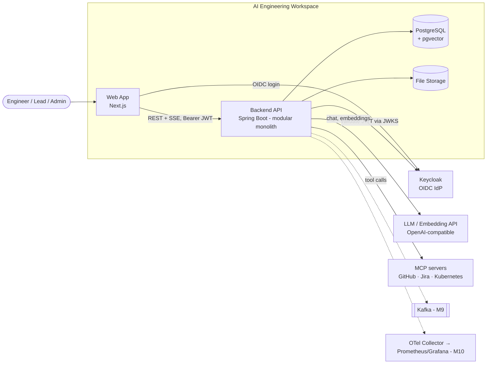

# Architecture — AI Engineering Workspace

> Status: **Baseline v1 (M0)** — decisions accepted, owner-reviewed 2026-10-15
> Last updated: 2026-10-14
> Related: [PRD](product/PRD.md) · [Database](database.md) · [API](api-design.md) · [ADRs](adr/README.md)

---

## 1. Architectural Style

**Modular monolith** (see [ADR-0001](adr/0001-modular-monolith.md)).

- One deployable Spring Boot backend, one Next.js frontend, one PostgreSQL database.
- Internally split into business modules with **explicit public APIs** and **enforced dependency rules**.
- A module is only extracted into a service when there is a concrete technical reason
  (independent scaling, different release cadence, failure isolation) — not before.

Why: the hard part of microservices is getting boundaries right. A modular monolith lets us
practice boundaries without paying for distributed transactions, network failures, and
multi-service deployment before we have any reason to.

---

## 2. System Context (target state, end of roadmap)



### Architecture evolution per milestone

| Milestone | Change to the picture |
| --- | --- |
| M1 | Next.js → Spring Boot → PostgreSQL, all in Docker Compose. Health check end-to-end. |
| M2 | + Keycloak. Backend becomes an OAuth2 Resource Server. |
| M3 | Business modules `project`, `task`, `note`. |
| M4 | + `knowledge` module, file storage, **synchronous in-process** parsing pipeline with status tracking. |
| M5 | + pgvector, embeddings, retrieval, LLM call (LangChain4j). |
| M6 | + `ai` module conversations/messages, SSE streaming. |
| M7 | + tools / agent loop, confirmation for write actions, audit. |
| M8 | + MCP client connections to external servers. |
| M9 | + Kafka: document pipeline becomes asynchronous (outbox, retry, DLQ, idempotent consumers). |
| M10 | + OpenTelemetry, Prometheus, Grafana. |
| M13–M14 | Production images, Helm chart, Kubernetes. |

The M4 → M9 change is deliberate: we build the pipeline synchronously first, **feel** its
limits (request timeouts, no retry, coupling), then introduce Kafka with a real reason.

---

## 3. Backend Module Design

### 3.1 Modules

| Module | Responsibility | Introduced |
| --- | --- | --- |
| `shared` | Cross-cutting *technical* pieces only: error model, pagination DTOs, clock, base config. **No business logic.** Must stay small. | M1 |
| `identity` | Security config, JWT → current user mapping, JIT user provisioning, user lookup. (Merges `auth` + `user` — D-03.) | M2 |
| `project` | Projects, membership, project roles, **project-level authorization checks**. | M3 |
| `task` | Tasks, status transitions, filtering. | M3 |
| `note` | Notes (Markdown). | M3 |
| `knowledge` | Documents, storage, parsing; later chunking, embeddings, retrieval. | M4–M5 |
| `ai` | Conversations, messages, LLM orchestration, tools, agent loop, MCP clients. | M5–M8 |

### 3.2 Dependency rules

```
ai ──────────► knowledge, task, note, project, identity
knowledge ───► project, identity
task ────────► project, identity
note ────────► project, identity
project ─────► identity
identity ────► (shared only)
all ─────────► shared
```

Rules:
1. **No cycles.** If two modules need each other, the boundary is wrong or an event is needed.
2. A module talks to another module **only through its public API** (a service in the module's
   root package). Never through another module's repository or entity.
3. **Entities are not shared** across modules. Cross-module references are by ID (`UUID projectId`).
4. **Authorization of project-scoped data goes through `project`**
   (e.g. `ProjectAccess.require(projectId, userId, ProjectRole.MEMBER)`), so the rule lives in one place.
5. The `ai` module's tools are **thin adapters** over other modules' public APIs. Tools never
   contain business rules or bypass authorization.
6. Rules are enforced by a test, not by discipline (Spring Modulith `ApplicationModules.verify()` in a test — D-05).

### 3.3 Package layout (per module)

Single Maven module, package-per-module (D-09):

```
dev.duyhd.aiworkspace.task                      ← public API of the module (other modules may use)
    TaskService                  ← application service: use cases, transactions
    TaskSummary, TaskStatus ...  ← public DTOs / enums exposed to other modules
dev.duyhd.aiworkspace.task.web                  ← REST controllers, request/response DTOs   (internal)
dev.duyhd.aiworkspace.task.internal             ← JPA entities, repositories, mappers        (internal)
```

Intentionally **not** hexagonal/ports-and-adapters with interfaces everywhere. One service class
per use-case area. Interfaces only where there are ≥ 2 implementations or a real seam
(e.g. `FileStorage` local vs S3, `DocumentParser` per file type, LLM client).

---

## 4. Key Runtime Flows

### 4.1 Authenticated request (M2+)

```
Browser → Next.js → GET /api/v1/projects (Authorization: Bearer <access_token>)
→ Spring Security: validate JWT signature (Keycloak JWKS, cached), issuer, audience, expiry
→ map claims → CurrentUser (JIT provision on first request)
→ controller → service: ProjectAccess check → repository → response
```

### 4.2 Document ingestion — M4 (sync) → M9 (async)

```
M4:  POST /documents (multipart) → validate type/size → checksum → store file
     → insert document(UPLOADED) → parse in-process → save text → status READY | FAILED
M5:  ... → chunk → embed (batch) → save chunks + vectors → READY
M9:  POST /documents → store + insert + outbox event in ONE transaction → 202
     → outbox relay → Kafka → document worker (idempotent) → parse/chunk/embed
     → status updates; failures → retry with backoff → DLQ
```

### 4.3 RAG query (M5)

```
question → embed(question)
→ similarity search in document_chunk WHERE project_id = :projectId  ← authorization filter
→ top-K chunks (+ score threshold) → prompt (system rules + context + question)
→ LLM → answer + sources (document, page/section, snippet)
→ if no chunk above threshold → "not found in knowledge base"
```

The `WHERE project_id = …` filter is a **security control**, not an optimization: without it,
RAG leaks documents across projects.

### 4.4 Agent with tools (M7)

```
user message → LLM (with tool specs) → tool_call(getBlockedTasks, {projectId})
→ ToolExecutor: authorize as current user → call TaskService → result → LLM → ...
→ final answer (streamed)

write tool (createTask) → status PROPOSED → UI confirmation → CONFIRMED → execute → audit
```
Guards: max tool iterations per turn, per-tool timeout, argument validation, audit log.

### 4.5 Streaming (M6)

Backend streams tokens via **SSE** (`text/event-stream`). Because the request is a POST with a
body, the frontend uses `fetch` + `ReadableStream` (not `EventSource`, which is GET-only).

---

## 5. Cross-Cutting Concerns

| Concern | Approach | From |
| --- | --- | --- |
| Errors | RFC 9457 Problem Details (`application/problem+json`), single global handler, stable error `code` | M1 |
| Validation | Bean Validation on request DTOs; domain invariants in services/entities | M3 |
| Transactions | `@Transactional` on application service methods only; no remote calls (LLM, storage) inside DB transactions | M3 |
| Concurrency | Optimistic locking (`version`) on mutable aggregates → 409 | M3 |
| Time | UTC everywhere; `Instant` ↔ `timestamptz` | M1 |
| IDs | UUID, generated by the application | M1 |
| Config | Spring profiles (`local`, `test`, `prod`), env vars for secrets, no secrets in git | M1 |
| Logging | Structured logs (JSON in non-local), correlation id per request in MDC | M1 |
| Schema migration | Flyway ([ADR-0007](adr/0007-flyway-migrations.md)) | M1 |
| API docs | OpenAPI generated from code (springdoc) | M3 |
| Security headers / CORS | Explicit CORS allow-list for the frontend origin | M1 |
| Observability | Actuator health (M1) → OTel traces/metrics (M10) | M1/M10 |

---

## 6. Frontend Architecture (overview)

- Next.js (App Router), TypeScript, Tailwind CSS, shadcn/ui.
- Server state via **TanStack Query**; forms validated with **Zod** (same rules as backend where possible).
- Typed API client in `src/lib/api`; one place for base URL, auth header, Problem Details parsing.
- Feature folders (`src/features/projects`, `tasks`, `notes`, `documents`, `assistant`).
- Auth integration pattern (server-side session / BFF vs browser PKCE) decided in **M2** via ADR.
  Constraint already fixed: **access tokens are never stored in `localStorage`**.

---

## 7. Known Risks & Open Questions

| # | Risk / question | Mitigation / when |
| --- | --- | --- |
| R1 | LangChain4j compatibility with Spring Boot 4 (starters may lag Boot majors) | Verify at M5 start; fallback: use LangChain4j core without starter, or Spring AI (ADR-0005) |
| R2 | Embedding dimension is fixed in the `vector(n)` column → changing model = re-embed + migration | Store `embedding_model` per chunk; decide model at M5 |
| R3 | Prompt injection via uploaded documents / tool results | Write actions require confirmation; tools authorized per user; system prompt rules; M15 review |
| R4 | `shared` module grows into a dumping ground | Rule: no business logic in `shared`; reviewed at each milestone gate |
| R5 | Sync document pipeline (M4–M8) blocks request threads on large files | Accept size limit (20 MB) until M9; virtual threads help but don't fix coupling |
| R6 | Local file storage doesn't work with multiple pods (M14) | `FileStorage` abstraction; decide local vs MinIO/S3 at M4 |
| R7 | LLM cost during development | Allow local model (e.g. Ollama, OpenAI-compatible) for dev; record tokens from M6 |
