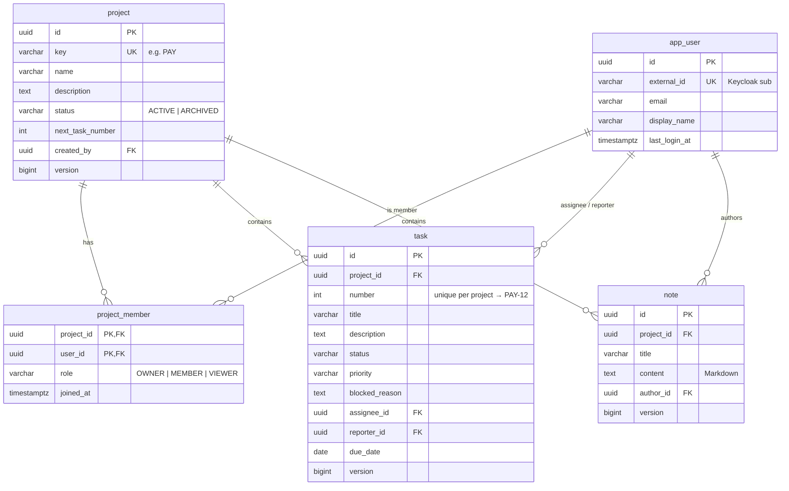

# Database Design — AI Engineering Workspace

> Status: **Baseline v1 (M0)** — high-level design. Exact columns are finalized in each milestone's
> Flyway migration and this file is updated accordingly.
> Last updated: 2026-10-14

---

## 1. Conventions

| Topic | Convention | Reason |
| --- | --- | --- |
| Engine | PostgreSQL (+ `pgvector` extension from M5) | One datastore for relational + vector ([ADR-0004](adr/0004-postgresql-pgvector.md)) |
| Schema | Single `public` schema; each table **owned by exactly one module** (table below) | Simple; ownership enforced in code. Alternative: schema-per-module (stronger, more ceremony) |
| Naming | `snake_case`, singular table names (`task`, `project_member`) | Consistent with JPA mapping |
| Primary key | `id uuid`, generated by the application | IDs known before insert, safe to expose, merge-friendly |
| Timestamps | `created_at`, `updated_at` as `timestamptz`, UTC | No timezone bugs |
| Concurrency | `version bigint` on mutable aggregates (optimistic locking) | Prevent lost updates (FR-17) |
| Enums | `varchar` + `CHECK` constraint (not PostgreSQL `ENUM` type) | Easier to evolve in migrations |
| Deletes | Hard delete, except `project` which is **archived** | Keep it simple; archive covers the "undo" need |
| Foreign keys | Always declared; every FK column indexed | Integrity + join/delete performance |
| Cross-module FKs | Allowed at DB level (same DB), but code references by ID only | DB integrity without coupling Java entities |
| Migrations | Flyway, `backend/src/main/resources/db/migration`, never edit an applied migration | [ADR-0007](adr/0007-flyway-migrations.md) |

---

## 2. Table Ownership

| Table | Owner module | Milestone |
| --- | --- | --- |
| `app_user` | identity | M2 |
| `project`, `project_member` | project | M3 |
| `task` | task | M3 |
| `note` | note | M3 |
| `document`, `document_content` | knowledge | M4 |
| `document_chunk` | knowledge | M5 |
| `conversation`, `message` | ai | M6 |
| `tool_execution` | ai | M7 |
| `outbox_event`, `processed_event` | shared / knowledge | M9 |

---

## 3. Core Model (M2–M3)

### `app_user` (M2)

- Identity lives in **Keycloak**; this table is a local projection so other tables can reference users.
- `external_id` = JWT `sub` claim, unique. Created on first login (JIT); `email`/`display_name` refreshed on login.
- No password, no roles here (global roles come from the token).

### `project` (M3)

- `key`: 2–10 uppercase letters, unique, immutable after creation.
- `next_task_number`: counter for human-readable task keys (`PAY-12`). Incremented under a row lock
  (`SELECT … FOR UPDATE` / pessimistic lock) when creating a task — a deliberate concurrency exercise. *(D-08.)*

### `project_member` (M3)

- PK `(project_id, user_id)`. Index on `user_id` ("my projects").
- Invariant (service-level): a project has ≥ 1 `OWNER`.

### `task` (M3)

- `status` ∈ `TODO, IN_PROGRESS, BLOCKED, DONE, CANCELLED`
- `priority` ∈ `LOW, MEDIUM, HIGH, CRITICAL`
- `CHECK (status <> 'BLOCKED' OR blocked_reason IS NOT NULL)`
- `UNIQUE (project_id, number)`
- Indexes: `(project_id, status)`, `(project_id, priority)`, `(assignee_id)`.

### `note` (M3)

- Markdown stored as `text`. Index `(project_id, updated_at DESC)` for listing.

---

## 4. Knowledge Model (M4–M5)

### `document` (M4)

| Column | Type | Notes |
| --- | --- | --- |
| id | uuid PK | |
| project_id | uuid FK | Knowledge is **project-scoped** (D-04) |
| original_filename | varchar(255) | Display only — never used as a storage path |
| content_type | varchar(100) | Validated by content sniffing, not just extension |
| size_bytes | bigint | ≤ 20 MB |
| checksum_sha256 | char(64) | `UNIQUE (project_id, checksum_sha256)` → duplicate detection (FR-23) |
| storage_key | varchar(500) | Generated key in file storage |
| status | varchar | `UPLOADED, PROCESSING, READY, FAILED` |
| failure_reason | text | Set when `FAILED` |
| uploaded_by | uuid FK app_user | |
| created_at / updated_at / version | | |

### `document_content` (M4)

`document_id` (PK, FK, cascade delete), `text`, `parser`, `page_count`, `parsed_at`.
Kept separate from `document` so list queries don't load large text.

### `document_chunk` (M5)

| Column | Type | Notes |
| --- | --- | --- |
| id | uuid PK | |
| document_id | uuid FK (cascade) | |
| project_id | uuid | **Denormalized** for the retrieval authorization filter |
| chunk_index | int | Order in the document |
| content | text | Chunk text (what gets cited) |
| metadata | jsonb | page, heading path, char offsets |
| token_count | int | |
| embedding | vector(N) | N depends on embedding model (decided M5) |
| embedding_model | varchar(100) | Enables safe model migration (risk R2) |

Indexes: HNSW on `embedding` (`vector_cosine_ops`), B-tree on `project_id`, `document_id`.

---

## 5. AI Model (M6–M7)

### `conversation` (M6)

`id`, `user_id` FK, `project_id` FK, `title`, `created_at`, `updated_at`.
Index `(user_id, project_id, updated_at DESC)`.

### `message` (M6)

| Column | Notes |
| --- | --- |
| id, conversation_id FK | |
| role | `USER, ASSISTANT, TOOL` |
| content | text |
| citations | jsonb — sources for RAG answers |
| model | model id used |
| input_tokens, output_tokens, latency_ms | cost & performance tracking (FR-42) |
| created_at | ordering |

### `tool_execution` (M7)

`id`, `message_id` FK, `tool_name`, `arguments jsonb`, `result jsonb`,
`status` (`PROPOSED, CONFIRMED, REJECTED, EXECUTED, FAILED`), `requested_by` FK, `decided_at`,
`executed_at`, `error`. This is the audit trail (FR-53).

---

## 6. Messaging Support (M9)

- `outbox_event`: `id`, `aggregate_type`, `aggregate_id`, `event_type`, `payload jsonb`, `created_at`, `published_at`.
  Written in the same transaction as the business change (transactional outbox).
- `processed_event`: `(consumer, event_id)` PK, `processed_at` — consumer idempotency.

---

## 7. Open Points

- M5: embedding model & dimension `N`; HNSW parameters.
- M15: partitioning/retention for `message` and `tool_execution` if volume grows.
